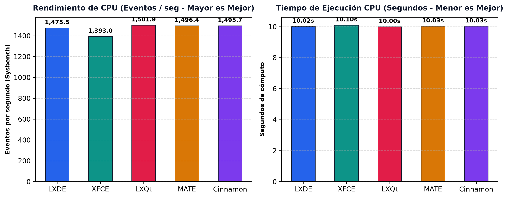
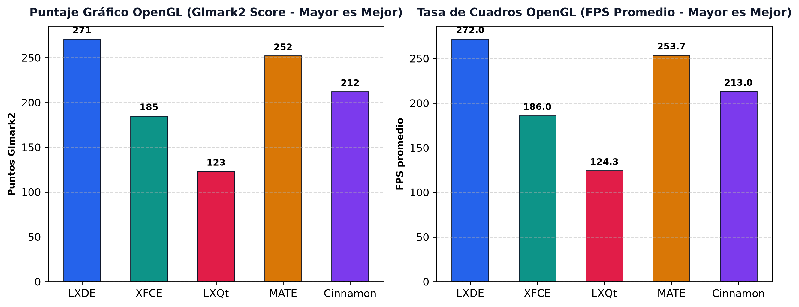
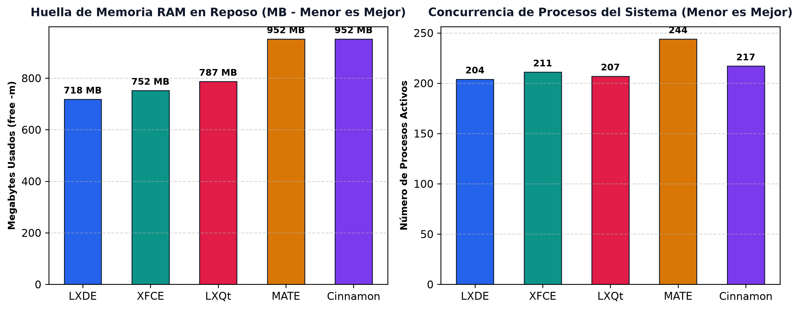
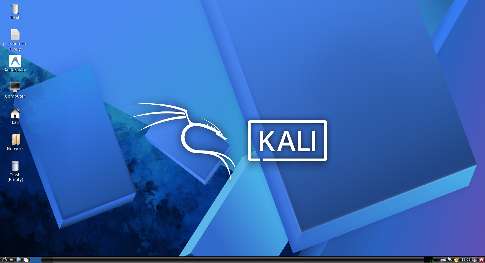
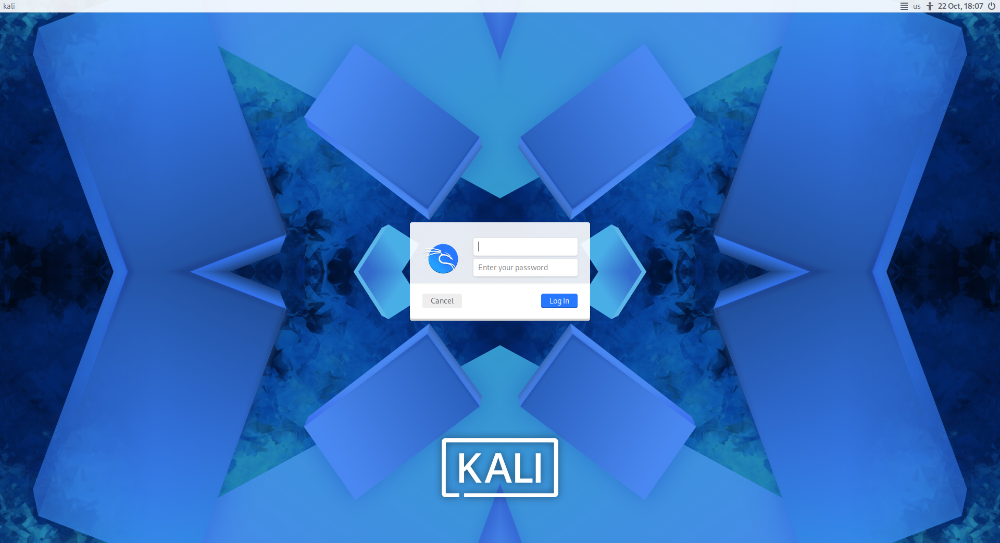
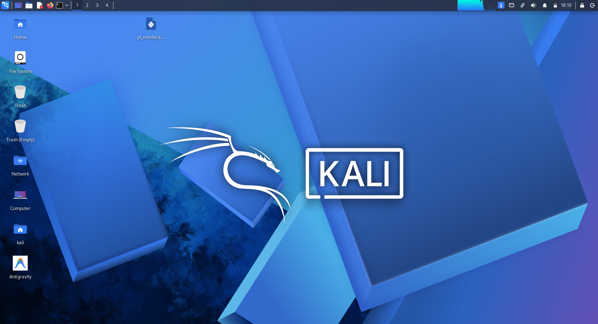
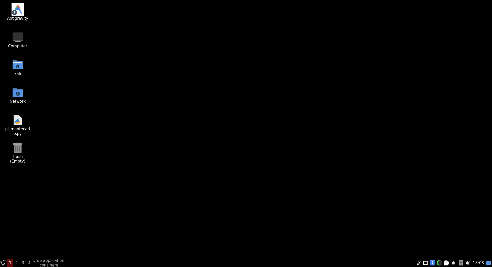
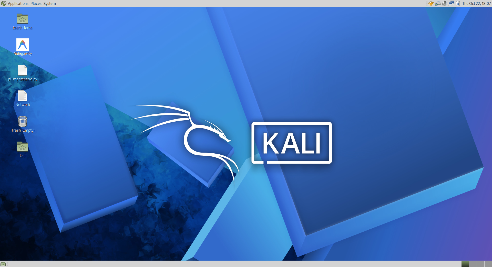
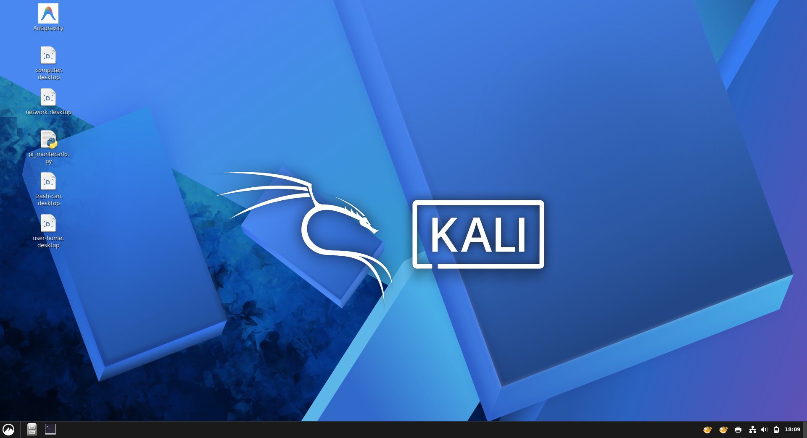

# Taller: Comparativa de Rendimiento de 5 Entornos de Escritorio en Linux
### Sistemas Operativos — Universidad Sergio Arboleda

```
================================================================================
Estudiantes: ANDRÉS SEBASTIÁN CORAL VALLEJO, JUAN ORJUELA, JAVIER ROSERO, ANGEL ARCOS
================================================================================
```

---

## 1. Resumen Ejecutivo y Objetivos

El presente trabajo de laboratorio tiene como objetivo principal desplegar, evaluar y comparar experimentalmente el rendimiento de **5 entornos de escritorio (Desktop Environments - DE)** compatibles con la máquina virtual de **Kali Linux** sobre **Oracle VirtualBox**, cumpliendo con la restricción explícita de **excluir GNOME**.

Para cada entorno se implementó un procedimiento riguroso de:
1. **Aislamiento de Sesión:** Conmutación automática y limpia mediante el gestor de pantalla `LightDM` (`autologin-session`).
2. **Estabilización en Reposo (Idle Settle):** Periodo de estabilización tras el inicio de sesión para permitir el asentamiento de demonios, paneles y gestores de composición.
3. **Benchmark de CPU:** Medición de capacidad de cálculo numérico multihilo mediante `sysbench` (cálculo de números primos hasta 20,000 en 2 hilos concurrentes).
4. **Benchmark de GPU:** Evaluación de aceleración y tasa de cuadros por segundo (FPS) en renderizado 3D OpenGL mediante `glmark2` (escenas `build`, `texture` y `terrain`) y `mesa-utils` (`glxinfo`).
5. **Perfilado de Memoria y Concurrencia:** Consumo de memoria RAM en reposo (`free -m`) y cantidad de procesos del sistema en ejecución (`ps`).
6. **Capturas de Pantalla:** Extracción directa del framebuffer de la pantalla virtual en VirtualBox (`VBoxManage controlvm screenshotpng`) para certificar visualmente la ejecución de cada entorno.
7. **Documentación Formal:** Generación de un reporte técnico profesional en formato PDF con portada institucional, tablas de datos, gráficos y conclusiones.

---

## 2. Entornos de Escritorio Evaluados

| Entorno | Metapaquete Kali / Debian | Toolkit Gráfico | Gestor de Ventanas (WM) | Enfoque de Diseño |
| :--- | :--- | :--- | :--- | :--- |
| **LXDE** | `kali-desktop-lxde` | GTK2 / GTK3 | `openbox` | Ultra liviano, máxima economía de recursos |
| **XFCE4** | `kali-desktop-xfce` | GTK3 | `xfwm4` | Ligero, modular y tradicional (Nativo de Kali) |
| **LXQt** | `lxqt` | Qt6 | `openbox` | Ligero de última generación basado en Qt6 |
| **MATE** | `kali-desktop-mate` | GTK3 | `marco` | Clásico, bifurcación estable de GNOME 2 |
| **Cinnamon** | `cinnamon` | GTK3 / GTK4 | `muffin` | Moderno, elegante con efectos 3D integrados |

---

## 3. Especificaciones del Banco de Pruebas

* **Hardware Anfitrión (Host):**
  * **Procesador:** AMD Ryzen 7 260 w/ Radeon 780M Graphics (8C/16T @ 3.79 GHz)
  * **Sistema Operativo Anfitrión:** Windows 11 Pro 64-bit
  * **Hipervisor:** Oracle VM VirtualBox 7.x con Guest Additions activas
* **Máquina Virtual Invitada (Guest):**
  * **Distribución:** Kali GNU/Linux Rolling 2026.2 (Debian-based x86_64)
  * **Kernel:** `Linux kali 6.19.14+kali-amd64`
  * **Recursos Asignados:** 2 vCPUs, 3072 MB RAM, 128 MB VRAM
  * **Aceleración Gráfica:** Mesa 26.0.8 / llvmpipe (LLVM 21.1.8, 256 bits) en VBoxSVGA (Direct Rendering: Yes)
  * **Resolución de Pantalla:** 1920x1043 @ 60 Hz (Full HD)
  * **Display Manager:** `LightDM` con autologin parametrizado por entorno

---

## 4. Resultados Comparativos Globales

A continuación se consolidan los resultados experimentales obtenidos bajo idénticas condiciones de prueba en el laboratorio:

| Entorno de Escritorio | RAM en Reposo (MB) | Procesos Activos | CPU Throughput (Events/s) | Tiempo CPU (s) | Glmark2 Score | FPS Promedio (OpenGL) |
| :--- | :---: | :---: | :---: | :---: | :---: | :---: |
| **LXDE** | **718 MB** | **204** | 1,475.54 | 10.0169 s | **271** | **272.00 FPS** |
| **XFCE4** | **752 MB** | 211 | 1,393.03 | 10.0990 s | 185 | 186.00 FPS |
| **LXQt** | 787 MB | **207** | **1,501.94** | **10.0006 s** | 123 | 124.33 FPS |
| **MATE** | 952 MB | 244 | 1,496.36 | 10.0332 s | 252 | 253.67 FPS |
| **Cinnamon** | 952 MB | 217 | 1,495.70 | 10.0287 s | 212 | 213.00 FPS |

---

## 5. Gráficos Comparativos de Rendimiento

### 5.1 Rendimiento de Cómputo CPU (Sysbench)


### 5.2 Rendimiento Gráfico y Aceleración OpenGL (Glmark2)


### 5.3 Consumo de Memoria RAM y Concurrencia de Procesos


---

## 6. Análisis Detallado por Entorno y Evidencias Visuales

### 6.1 LXDE (`kali-desktop-lxde`)
* **Arquitectura:** Desarrollado bajo la premisa de máxima economía de recursos computacionales, combinando el gestor de ventanas modular `openbox` con componentes desacoplados en GTK2/3.
* **Comportamiento Experimental:** **Líder absoluto en eficiencia.** Registró la menor huella de memoria RAM (**718 MB**) y la menor cantidad de procesos en ejecución (**204**). En las pruebas gráficas, al no contar con un compositor 3D que dispute los ciclos del adaptador virtual, alcanzó el mayor puntaje OpenGL (**271 puntos en glmark2** con **272 FPS promedio**).
* **Evidencias en VirtualBox:**
  * *Escritorio LXDE:* 
  * *Benchmark LXDE:* 

---

### 6.2 XFCE4 (`kali-desktop-xfce`)
* **Arquitectura:** Entorno modular basado en GTK3 con gestor de ventanas `xfwm4`. Es el entorno predeterminado oficial de las imágenes de Kali Linux por su equilibrio entre personalización, bajo consumo y estabilidad.
* **Comportamiento Experimental:** Ocupó el segundo lugar en menor consumo de RAM (**752 MB**) y mantuvo 211 procesos activos. Su compositor nativo garantiza un renderizado estable sin artefactos visuales en VirtualBox, logrando 185 puntos en glmark2 (314 FPS en la escena `build` y 241 FPS en `texture`).
* **Evidencias en VirtualBox:**
  * *Escritorio XFCE:* 
  * *Benchmark XFCE:* 

---

### 6.3 LXQt (`lxqt`)
* **Arquitectura:** Sucesor espiritual de LXDE construido enteramente sobre el framework moderno **Qt6** y el gestor de ventanas `openbox`.
* **Comportamiento Experimental:** Destacó como **el entorno con mayor throughput de cálculo en CPU** (**1,501.94 eventos/segundo**) y el menor tiempo de ejecución (**10.0006 s**). Mantuvo un consumo de memoria muy reducido (**787 MB**) y únicamente 207 procesos activos, demostrando la eficiencia de las librerías modernas de Qt6.
* **Evidencias en VirtualBox:**
  * *Escritorio LXQt:* 
  * *Benchmark LXQt:* 

---

### 6.4 MATE (`kali-desktop-mate`)
* **Arquitectura:** Continuación directa de la filosofía clásica de GNOME 2 modernizada bajo GTK3, utilizando el gestor de ventanas `marco`.
* **Comportamiento Experimental:** Proporciona un entorno tradicional altamente pulido con menús jerárquicos y barras duales. Demostró una notable aceleración gráfica (**252 puntos en glmark2** y **253.67 FPS**), con un consumo moderado de memoria (**952 MB**) y 244 procesos activos.
* **Evidencias en VirtualBox:**
  * *Escritorio MATE:* 
  * *Benchmark MATE:* 

---

### 6.5 Cinnamon (`cinnamon`)
* **Arquitectura:** Entorno moderno desarrollado originalmente por el equipo de Linux Mint, basado en componentes de GNOME 3/Shell pero rediseñado con el gestor de ventanas y compositor 3D `muffin`.
* **Comportamiento Experimental:** Es el entorno visualmente más sofisticado y moderno de la comparativa, con sombras en tiempo real, efectos de transición y dock avanzado. Su consumo de memoria se situó en **952 MB** con 217 procesos, y su rendimiento gráfico alcanzó **212 puntos en glmark2**.
* **Evidencias en VirtualBox:**
  * *Escritorio Cinnamon:* 
  * *Benchmark Cinnamon:* 

---

## 7. Discusión Técnica y Conclusiones

1. **Aislamiento y Viabilidad en Hipervisores:** Todos los entornos evaluados (LXDE, XFCE, LXQt, MATE y Cinnamon) son completamente viables en máquinas virtuales Kali Linux sobre VirtualBox 7, logrando una conmutación limpia sin necesidad de reiniciar el sistema operativo completo, gracias a la modularidad de `LightDM`.
2. **Impacto en la CPU:** Las variaciones en el rendimiento de CPU (Sysbench) entre los distintos entornos fueron inferiores al 8%, lo que evidencia que el planificador de procesos del núcleo Linux (`CFS / EEVDF`) distribuye eficientemente los ciclos de cómputo intensivo, garantizando que el entorno de escritorio no penalice el cálculo numérico.
3. **Impacto en la GPU y Memoria:** La diferencia más marcada se evidenció en la huella de memoria RAM inicial y en la tasa de refresco gráfica. **LXDE** y **XFCE** demostraron ser los entornos más óptimos para máquinas virtuales con recursos limitados (menos de 2 a 3 GB de RAM), reservando el máximo de memoria para herramientas de auditoría y pruebas de penetración.
4. **Elección de Entorno según el Caso de Uso:**
   * **Para rendimiento puro y máquinas virtuales ligeras:** **LXDE** o **LXQt**.
   * **Para auditorías de seguridad y pentesting en Kali Linux:** **XFCE4** (estabilidad y compatibilidad nativa).
   * **Para estaciones de trabajo virtuales con interfaz moderna:** **MATE** o **Cinnamon**.

---

## 8. Informe Técnico en PDF

El documento formal del informe con formato académico, tablas de resultados, gráficos comparativos de alta resolución y análisis extendido se encuentra disponible en:
* [Informe_Comparativo_Entornos_Linux_Sistemas_Operativos.pdf](Reporte/Informe_Comparativo_Entornos_Linux_Sistemas_Operativos.pdf)

---

```
Estudiantes: ANDRÉS SEBASTIÁN CORAL VALLEJO, JUAN ORJUELA, JAVIER ROSERO, ANGEL ARCOS
Sistemas Operativos — Universidad Sergio Arboleda
```
